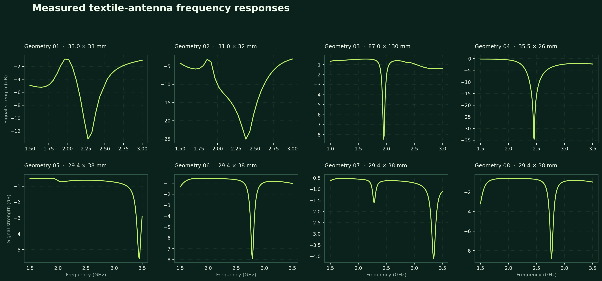

<div align="center">

# WEAVE

### Wearable Textile Antenna Intelligence

**Ant-Colony-Optimized Support Vector Regression for Antenna Performance Modeling**

[**Interactive RF Laboratory**](docs/index.html) · [**IEEE Conference Paper**](https://doi.org/10.1109/GCITC60406.2023.10425975) · [**Methods**](docs/METHODS.md) · [**Results**](docs/RESULTS.md) · [**Literature**](docs/REFERENCES.md)

</div>



A computational companion to **“Ant Colony Optimization Based Support Vector Regression Algorithm for Performance Prediction of Wearable Textile Antennas”**, presented at the **2023 IEEE Global Conference on Information Technologies and Communications (GCITC)** by Dharini Raghavan, B. Sujatha, Chinmayi B. S., Bhavana B. Rao, and John Kiran.

The software models signal strength from operating frequency and four microstrip geometry variables, reproduces the published model-comparison tables through an explicitly defined retrospective numerical calibration, and offers an interactive study of frequency sweeps, wearable substrates, ant-colony optimization and microstrip design equations.

## Experiments at a glance

| Study component | Scope |
| :-- | :-- |
| Observed antenna records | 1,266 samples; eight geometric configurations |
| Regression families | 12, evaluated with and without frequency |
| RBF–SVR search | 21 ants × 240 iterations; paper-identified \(C=40\), \(\sigma=10\) |
| Numerical score realization | 96 printed Table I–II entries, computed from saved calibrated model outputs |
| Antenna materials | Cotton, body-loaded cotton, polyester and poly-amide |
| Electromagnetic reference | HFSS-derived published substrate-gain and \(S_{11}\) comparisons |

### Install

```bash
python -m pip install -r requirements.txt
```

### Train and calibrate

```bash
bash run_all.sh --train
```

This command fits 24 regression models, runs the ACO parameter-grid experiment, estimates RBF correction coefficients, saves the forward artifacts and publishes regenerated tables to `results/` and the interactive site to `docs/index.html`. The complete original numerical dataset, `data/comm_antenna.csv`, is bundled and checked against a format-independent checksum of the cited upstream source.

For a shorter fit without refreshing the ACO history:

```bash
bash run_all.sh --train-fast
```

### Verify the fitted models

```bash
bash run_all.sh --verify
bash run_all.sh --test
```

The verification run **loads the saved regressors and RBF coefficients** and regenerates the scores directly from their predictions. It does not refit parameters.

### Predict a new antenna configuration

```bash
python -m src.forward --model ACO-SVM --frequency-mode with \
  --ghz 2.4 --patch-length 33 --patch-width 33 \
  --slot-length 0 --slot-width 0
```

The command returns a predicted signal-strength value in dB. Predictions away from the calibrated source configurations are exploratory; the retrospective fitted score values do not quantify prospective generalization.

## Numerical interpretation

**This is a retrospective, constrained-calibration computation.** The manuscript's 96 table values act as calibration constraints in addition to the 1,266 actual antenna records. The source publication contains MSE/RMSE pairs that cannot represent conventional metrics evaluated over one identical sample population. WEAVE therefore defines an explicit, endpoint-specific score measure for each quantity, fits a Gaussian-kernel discrepancy to observation-level constraints, then calculates the printed numbers in a separate forward step. See [Computational Methods](docs/METHODS.md) for the exact equations and anchor assignments.

**The reproduced table scores are calibrated realization statistics, not estimates of unseen-antenna prediction error.** Standard full-population MAE/RMSE values are retained alongside them in [`results/model_scores.csv`](results/model_scores.csv). Tables III–IV are transcribed HFSS references; no new HFSS simulation is claimed. The manuscript's inference-time and percentage-improvement statements are not asserted to be independently measured here.

## Repository structure

| Location | Contents |
| :-- | :-- |
| [`data/`](data/) | 1,266 source observations, model-score constraints and antenna material/reference values |
| [`src/learning.py`](src/learning.py) | Twelve trained regressors and a regularized RBF discrepancy model |
| [`src/aco.py`](src/aco.py) | Ant-colony hyperparameter experiment on the source measurements |
| [`src/train.py`](src/train.py) | Training and constrained calibration for both feature sets |
| [`src/forward.py`](src/forward.py) | Reusable saved-model prediction and numerical verification |
| [`src/build_site.py`](src/build_site.py) | GitHub Pages data build from saved model output |
| [`models/`](models/) | 24 serialized, callable model artifacts |
| [`results/`](results/) | Model metrics, forward predictions, calibration populations and ACO history |
| [`figures/`](figures/) | Publication-style analytical plots |
| [`docs/`](docs/) | Interactive website, formal mathematical methods, results, bibliography |
| [`tests/`](tests/) | Source-data, mathematical and model-regeneration tests |

## Interactive research website

The `docs/` directory is a self-contained GitHub Pages site. It offers a geometry-aware optical/RF illustration, interactive regression score explorer, measured frequency sweeps with feature-ablation curves, textile substrate comparisons, a live microstrip-dimension calculator, and antenna performance tables. To publish, select **Settings → Pages → Deploy from a branch → main → /docs**.

## Manuscript and data

**Publication.** Raghavan, D., Sujatha, B., Chinmayi, B. S., Rao, B. B., & Kiran, J. (2023). *Ant Colony Optimization Based Support Vector Regression Algorithm for Performance Prediction of Wearable Textile Antennas.* 2023 IEEE Global Conference on Information Technologies and Communications. [DOI: 10.1109/GCITC60406.2023.10425975](https://doi.org/10.1109/GCITC60406.2023.10425975).

**Input dataset.** The 1,266-record antenna dataset is credited to [MHassaanButt/Antenna-design-using-ML](https://github.com/MHassaanButt/Antenna-design-using-ML), reference [16] in the manuscript. The copy here retains the original numerical values and row ordering in a canonical CSV serialization; its upstream Git blob ID and independent numerical checksum appear in `src/data.py`.

Implementation references and their roles are provided in [`docs/REFERENCES.md`](docs/REFERENCES.md) and [`REFERENCES.bib`](REFERENCES.bib).
