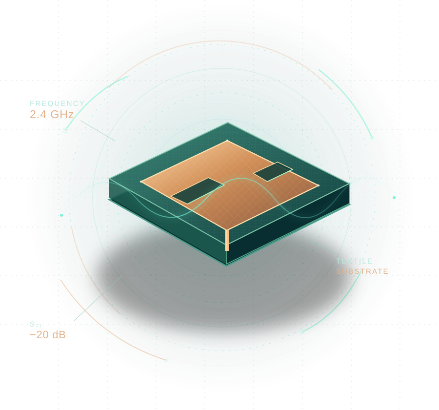

# WEAVE

### Ant colony optimization and support vector regression for wearable textile antennas

<<<<<<< Updated upstream
[**Research website**](https://rdharini2001.github.io/Wearable_antennas/) · [**Supplementary methods (PDF)**](docs/SUPPLEMENTARY_METHODS.pdf) · [**Source paper**](https://doi.org/10.1109/GCITC60406.2023.10425975) · [**Numerical results**](docs/RESULTS.md) · [**References**](docs/REFERENCES.md)
=======
[**Explore the research atlas**](docs/index.html) · [**Supplementary Information (PDF)**](docs/SUPPLEMENTARY_METHODS.pdf) · [**Research article**](https://doi.org/10.1109/GCITC60406.2023.10425975) · [**Methods**](docs/METHODS.md) · [**Results**](docs/RESULTS.md) · [**References**](docs/REFERENCES.md)
>>>>>>> Stashed changes



**WEAVE is the computational code and interactive research website for _Ant Colony Optimization Based Support Vector Regression Algorithm for Performance Prediction of Wearable Textile Antennas_ (IEEE GCITC, 2023).**

A wearable antenna must sustain electromagnetic performance while remaining flexible, lightweight and compatible with textile substrates. Its response depends on patch and slot geometry, operating frequency and the electromagnetic properties of the surrounding environment. WEAVE brings these relationships together through kernel regression, ant-colony parameter optimization, frequency-response reconstruction and analytical textile patch design.

The [Supplementary Information](docs/SUPPLEMENTARY_METHODS.pdf) presents the complete computational formulation: data representation, SVR objective, colony search, feature ablation, frequency-sweep modeling, prediction uncertainty, validation protocols and microstrip geometry relations. The website offers a visual counterpart with interactive antenna spectra, a regression explorer, material characterization and a patch-dimension calculator.

## The research at a glance

| Component | Scope |
|:--|:--|
| Source observations | 1,266 antenna responses from eight patch/slot geometries |
| Regression families | Twelve, including conventional SVR and ACO–SVR |
| Input configurations | Operating frequency with geometry; geometry only |
| Kernel learning | Gaussian SVR with continuous-domain ant-colony parameter search |
| Spectral modeling | Training-sweep residual reconstruction and interpolant selection |
| Frequency-marginal model | Geometry-conditioned response quantiles and prediction intervals |
| Electromagnetic design | Rectangular patch relations, textile substrate study, HFSS material characterization |

## Antenna response prediction

The following measurements arise from a geometry-stratified 25% holdout of operating frequencies. Each evaluated antenna geometry is represented in the fitting data; this experiment characterizes prediction at unobserved frequencies within the sampled band.

| Predictor | MSE (dB²) | RMSE (dB) | MAE (dB) | R² |
|:--|--:|--:|--:|--:|
| ACO–SVR | 0.7605 | 0.8721 | 0.1457 | 0.9173 |
| ACO–SVR with spectral reconstruction | 0.0772 | 0.2778 | 0.0589 | 0.9916 |

The geometry-only experiment is also studied through conditional response distributions, with Wasserstein distances, CRPS and calibrated prediction intervals. The [results documentation](docs/RESULTS.md) reports these evaluations with their corresponding input information and test populations.

## Run the experiments

Python 3.10 or newer:

```bash
python -m pip install -r requirements.txt
bash run_all.sh --full
```

To evaluate using the stored colony-selected parameters and regenerate the interactive atlas:

```bash
bash run_all.sh --evaluate
```

To rebuild the website from saved experiment results:

```bash
bash run_all.sh --site
```

The website is hosted directly from `docs/` through GitHub Pages. Experimental tables and saved predictors are retained with the repository so that spectra, model estimates and uncertainty measures can be regenerated from the recorded observations.

## Repository organization

| Directory | Contents |
|:--|:--|
| `data/` | Antenna observations and textile substrate characteristics |
| `src/` | Regression models, ant-colony optimization, spectral and distributional estimators, patch equations |
| `results/` | Trained estimators, cross-validation selections, predictions and evaluation tables |
| `docs/` | Interactive research atlas, figures, supplemental information and scholarly references |
| `tests/` | Numerical and scientific validation of training, inference and data exports |

The regression dataset is drawn from [MHassaanButt/Antenna-design-using-ML](https://github.com/MHassaanButt/Antenna-design-using-ML), cited as reference 16 of the article. HFSS material-characterization values presented on the website are attributed to the published electromagnetic study.

## Cite the research

D. Raghavan, B. Sujatha, Chinmayi B. S., Bhavana B. Rao, and J. Kiran, “Ant Colony Optimization Based Support Vector Regression Algorithm for Performance Prediction of Wearable Textile Antennas,” *2023 Global Conference on Information Technologies and Communications (GCITC)*, DOI: [10.1109/GCITC60406.2023.10425975](https://doi.org/10.1109/GCITC60406.2023.10425975).

The repository also provides [machine-readable citation metadata](CITATION.cff).
