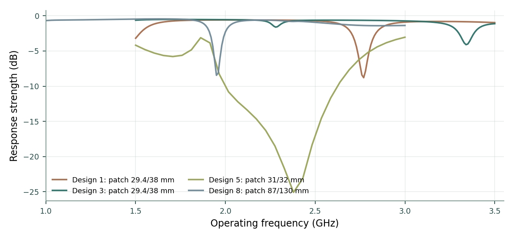

# Supplementary Information

## Ant Colony Optimization–Based Support Vector Regression for Performance Prediction of Wearable Textile Antennas

**Computational methodology, spectral reconstruction and electromagnetic design relations**

Dharini Raghavan, B. Sujatha, Chinmayi B. S., Bhavana B. Rao and John Kiran

*Supplementary material accompanying the paper published in the 2023 Global Conference on Information Technologies and Communications (GCITC).*  
DOI: [10.1109/GCITC60406.2023.10425975](https://doi.org/10.1109/GCITC60406.2023.10425975)

### Abstract

The electromagnetic behavior of textile antennas depends jointly on the dimensions of the radiating patch, the configuration of its slots, the dielectric properties of the substrate and the operating frequency. This supplementary information describes the computational methodology used to study those relationships with support vector regression and ant-colony parameter optimization. We provide the data representation, kernel formulation, parameter-selection objective and evaluation protocol in sufficient detail to support the executable research code. We then describe two frequency-response treatments: a smooth spectral correction for interpolation within a characterized antenna design, and a frequency-marginal representation for situations in which the operating frequency is not supplied at inference. Analytical microstrip relations and the electromagnetic substrate study complete the connection between numerical prediction and antenna design. The resulting workflow supports response prediction, examination of model sensitivity and quantitative investigation of wearable textile substrates.

## S1. Antenna response data and feature representation

The numerical experiments use the antenna-response dataset cited in the research article [1, 2]. It comprises 1,266 measurements across eight configurations of patch and slot geometry. Each configuration is characterized by a sweep of operating frequencies. A record contains the excitation frequency, four geometric dimensions and the corresponding response strength. The response is represented in decibels (dB); the patch and slot dimensions are in millimeters and the operating frequency is in gigahertz.

**Table S1. Variables used for antenna-response regression.**

| Symbol | Data field | Description | Unit |
|:--|:--|:--|:--|
| $f$ | `TestFreq` | Operating frequency | GHz |
| $L_p$ | `PatchLength` | Length of the radiating patch | mm |
| $W_p$ | `PatchWidth` | Width of the radiating patch | mm |
| $L_s$ | `SlotLength` | Slot length | mm |
| $W_s$ | `SlotWidth` | Slot width | mm |
| $y$ | `Strength` | Antenna response strength | dB |

We write the design vector as $g=(L_p,W_p,L_s,W_s)$ and the full predictor as $x=(f,g)$. This separation is useful because geometry describes the fabricated structure whereas frequency identifies a point on its electromagnetic response curve. The dataset is organized by geometry before experimental partitioning so that frequency samples from a given design can be identified consistently.

The source response, simulated radiation gain and input reflection coefficient describe related but distinct antenna properties. The response-regression models described here use `Strength` as the supervised target. The electromagnetic substrate section concerns gain and $S_{11}$ and is treated separately.

## S2. Data preparation and experimental partitions

Numerical inputs are assembled in a consistent order, and scaling parameters are estimated from the training portion of each experiment. For continuous models, the standardized predictor is

$$
\widetilde{x}_j=\frac{x_j-\mu_j}{s_j},
$$

where $\mu_j$ and $s_j$ are the training-set mean and standard deviation of feature $j$. A zero-variance feature is handled by the estimator's scaling convention. Tree-based learners operate on the geometric variables in their native representation.

Two complementary partitions are used. In the **frequency-interpolation experiment**, a geometry-stratified split reserves 25% of the sampled frequencies for testing, while each of the eight antenna configurations remains represented in the training population. This protocol examines prediction at unobserved frequency samples of characterized designs. The default split seed is 2023, producing 949 fitting records and 317 evaluation records.

In the **geometry-transfer experiment**, complete patch/slot configurations are withheld from fitting. The test designs therefore do not contribute response measurements to the learned model. This experiment examines transfer across geometry rather than interpolation within a previously characterized spectrum. For both protocols, parameter optimization takes place within the training population, with preprocessing re-estimated on the appropriate fitting folds. These partitions make the two generalization questions explicit and allow them to be studied on the same underlying antenna dataset.

## S3. Support vector regression formulation

Let $\{(x_i,y_i)\}_{i=1}^n$ be the labeled fitting set. Epsilon-insensitive support vector regression seeks a function $h(x)=\langle w,\phi(x)\rangle+b$ by minimizing

$$
\underset{w,b,\xi,\xi^*}{\operatorname{minimize}}\quad
\frac{1}{2}\|w\|_2^2+C\sum_{i=1}^{n}(\xi_i+\xi_i^*),
$$

subject to

$$
\begin{aligned}
y_i-h(x_i)&\leq\epsilon+\xi_i,\\
h(x_i)-y_i&\leq\epsilon+\xi_i^*,\\
\xi_i,\xi_i^*&\geq0.
\end{aligned}
$$

The coefficient $C$ governs the trade-off between the complexity of the fitted response and deviations beyond the insensitive region $\epsilon$. The radial basis function (RBF) kernel gives a flexible nonlinear dependence on antenna variables:

$$
K(x,z)=\exp\!\left(-\frac{\|\widetilde x-\widetilde z\|_2^2}{2\sigma^2}\right)
=\exp\!\left(-\gamma\|\widetilde x-\widetilde z\|_2^2\right),
\qquad\gamma=(2\sigma^2)^{-1}.
$$

Here $\sigma$ is a bandwidth in the standardized predictor space. The fitted regressor is a finite expansion over support vectors; $C$, $\sigma$ and $\epsilon$ jointly determine its smoothness, flexibility and tolerance to local deviations [3].

## S4. Ant-colony selection of kernel parameters

The ant-colony search explores the continuous parameter domain using a ranked archive of candidate solutions, following the continuous optimization principles described by Socha and Dorigo [4]. Each candidate specifies a penalty and bandwidth; the optimization is performed in logarithmic coordinates to permit proportional rather than additive changes across scales.

For $\theta=(\log(C/s_y),\log(\sigma/s_x))$, the scales $s_y$ and $s_x$ are estimated from the current training population. A space-filling initial design establishes a diverse candidate archive. At each colony step, existing candidates are sampled with a rank-dependent preference, and new points are generated through Gaussian perturbations in the continuous search coordinates. A candidate's quality is assessed using the validation folds of the relevant experiment. Cached evaluations make the search deterministic for a given dataset and seed.

For $K$ validation folds, the selection criterion is

$$
J(\theta)=\frac{1}{K}\sum_{k=1}^{K}e_k(\theta)
+\frac{\operatorname{sd}\{e_k(\theta)\}}{\sqrt K}
+\frac{\overline{r}_{\mathrm{SV}}(\theta)}{\sqrt n},
$$

where $e_k$ is the fold MAE normalized by a training-response scale and $\overline r_{\mathrm{SV}}$ is the average fraction of training samples acting as support vectors. The first term favors accurate predictions, the second favors stable performance across validation folds, and the final term places a modest preference on parsimonious kernel representations. Grouped folds are used when the experiment targets unseen antenna designs.

The computational specification uses 21 ants and permits 240 colony iterations, with a configurable budget of unique model evaluations (65 in the distributed experiment). After selection, the RBF-SVR estimator is refitted using the complete training subset and the selected parameters. The archive, chosen parameters and model are saved to permit deterministic evaluation and subsequent antenna-response prediction.

## S5. Comparative regression study and frequency ablation

The analysis includes partial least-squares regression, principal-component regression, ordinary least squares, ridge regression, lasso, Bayesian ridge regression, ElasticNet, random forest, decision tree, polynomial regression, standard RBF-SVR and ant-colony-optimized SVR. These twelve families span linear, regularized, projection-based, tree-based and kernel estimators.

Each family is studied in two feature settings. The first uses operating frequency together with the four patch and slot variables. The second uses geometry alone:

$$
\widehat y_{\mathrm{full}}=h(f,L_p,W_p,L_s,W_s),\qquad
\widehat y_{\mathrm{geom}}=h(L_p,W_p,L_s,W_s).
$$

The ablation isolates the contribution of frequency information to response prediction. Its interpretation follows the structure of the data: because a single geometry can have multiple response values over a frequency sweep, a geometry-only point estimator is a conditional summary of those responses. We also examine a distribution-valued estimator in Section S7 to characterize their variation directly.

## S6. Spectral reconstruction of the antenna response

Textile patch antennas exhibit narrow resonant features that can be difficult for a global regression surface to resolve uniformly. A frequency sweep provides a valuable local view of these features. For a geometry $g$ already represented by fitting observations, we estimate the difference between the response measurements and the global SVR prediction:

$$
r_i=y_i-h_{\mathrm{SVR}}(f_i,g),\qquad
\widehat y(f,g)=h_{\mathrm{SVR}}(f,g)+s_g(f).
$$

The function $s_g$ interpolates the residuals observed at the training frequencies of geometry $g$. It acts as a local correction to the global geometry-frequency relationship: the SVR represents the general response, while the spectral term resolves the geometry-specific structure between characterized frequency samples. For discontinuous tree-based predictors, direct interpolation of the training response is used instead of residual interpolation.

Four interpolants are considered: natural cubic splines, Akima interpolation, piecewise cubic Hermite interpolation (PCHIP) and linear interpolation [5–7]. Their behavior differs near rapid changes and local extrema. Selection is therefore performed on an internal holdout within the outer fitting population, using the sum of MAE and RMSE on that internal validation set. The selected interpolant is then constructed from the available fitting frequencies. Endpoint behavior is kept bounded through the prescribed local interpolation rule.

This formulation is suited to the reconstruction of missing frequencies in an already characterized design. For an antenna geometry with no characterized sweep, prediction is supplied by the global regression model. The distinction is useful for separating spectral resolution from extrapolation across new shapes.

{ width=76% }

**Figure S1.** Representative response-strength spectra for four textile antenna designs. Their distinct resonant minima motivate the local frequency-response reconstruction.

## S7. Frequency-marginal representation and uncertainty

A wearable antenna may also be described by its geometry before a particular operating frequency is specified. In that setting, the predicted quantity is naturally a response distribution over the sampled band rather than a single location on the sweep.

Let $F_g$ denote the conditional distribution of response strength associated with geometry $g$ under the frequency-sampling measure of the experiment. Its quantile function is

$$
Q_g(q)=\inf\{t:F_g(t)\geq q\},\quad 0<q<1.
$$

The frequency-marginal model constructs a smooth training-derived response curve for each represented design and uses that curve to estimate its conditional response distribution. At inference, the supplied variables are the four geometric dimensions; no operating frequency is required to obtain mean response, median response, quantiles or prediction intervals. This interpretation treats the sampled frequency band and its sampling measure as part of the definition of the distribution.

**Distributional evaluation.** For a geometry with $m_g$ held-out responses, let $y_{g,(j)}$ be its ordered evaluation values, and set $q_j=(j-1/2)/m_g$. The one-dimensional optimal transport construction provides

$$
W_1=\frac{1}{N}\sum_g\sum_{j=1}^{m_g}|\widehat Q_g(q_j)-y_{g,(j)}|,
$$

$$
W_2=\left[\frac{1}{N}\sum_g\sum_{j=1}^{m_g}\left(\widehat Q_g(q_j)-y_{g,(j)}\right)^2\right]^{1/2},
\qquad N=\sum_g m_g.
$$

The ordered coupling captures agreement between entire frequency-response distributions rather than the error at an individually specified frequency [8]. The corresponding distributional explained-variance measure uses the squared transport distance normalized by the variance of the ordered responses. Point-prediction metrics continue to be computed from paired point forecasts and their observations, while transport metrics refer to response distributions.

**Probabilistic calibration.** Distributional forecasts are assessed using the continuous ranked probability score (CRPS),

$$
\operatorname{CRPS}(F,y)=\mathbb E|X-y|-\tfrac12\mathbb E|X-X'|,\qquad X,X'\sim F,
$$

and by the coverage and width of prediction intervals [9]. A distinct calibration subset is used to determine an interval-expansion quantile at nominal 90% coverage. The calibrated interval is then evaluated on withheld observations. This procedure provides an interpretable measure of uncertainty in the response expected from a given textile geometry.

## S8. Analytical textile patch design

The electromagnetic design stage follows rectangular microstrip relations that connect substrate permittivity and resonant frequency to antenna dimensions [1, 10]. Given desired resonance $f_r$, free-space wave speed $c_0$, substrate relative permittivity $\varepsilon_r$ and substrate thickness $h$, a first estimate of the patch width is

$$
W=\frac{c_0}{2f_r}\sqrt{\frac{2}{\varepsilon_r+1}}.
$$

The effective permittivity accounts approximately for fringing fields propagating partly in the substrate and partly in air:

$$
\varepsilon_{\mathrm{eff}}=\frac{\varepsilon_r+1}{2}+\frac{\varepsilon_r-1}{2}\left(1+12\frac hW\right)^{-1/2}.
$$

The fringing extension is estimated as

$$
\frac{\Delta L}{h}=0.412\frac{(\varepsilon_{\mathrm{eff}}+0.3)(W/h+0.264)}{(\varepsilon_{\mathrm{eff}}-0.258)(W/h+0.8)},
$$

and the corresponding physical patch length and nominal ground-plane dimensions are

$$
L=\frac{c_0}{2f_r\sqrt{\varepsilon_{\mathrm{eff}}}}-2\Delta L,
\qquad L_g=L+6h,\quad W_g=W+6h.
$$

These expressions provide a useful analytical starting geometry. The dimensions of slots, feed configuration, finite ground plane and proximity to the human body can alter the subsequent electromagnetic response and are included in design assessment.

## S9. Textile substrates and electromagnetic characterization

The substrate study considers cotton, polyester and poly-amide, with cotton additionally evaluated in the presence of body tissue. Textile permittivity influences the electrical size of the antenna, while nearby tissue changes the electromagnetic boundary conditions and hence the simulated gain and input matching.

**Table S2. HFSS characterization at 2.4 GHz, from the antenna study [1].**

| Substrate condition | Relative permittivity | Gain (dBi) |
|:--|--:|--:|
| Cotton, without body tissue | 1.1 | 6.8 |
| Cotton, with body tissue | 1.1 | 9.6 |
| Polyester | 4.2 | 4.7 |
| Poly-amide | 2.7 | 5.9 |

The reflection coefficient $S_{11}$ describes the portion of the incident wave reflected at the antenna feed. It is conventionally expressed in decibels as $20\log_{10}|\Gamma|$ for voltage reflection coefficient $\Gamma$. For wearable operation, both input matching and radiation behavior should be considered with the appropriate substrate and body-tissue configuration. The analytical geometry relations, regression outputs and HFSS observables play complementary roles in the design procedure.

## S10. Evaluation measures and representative results

For $N$ paired observations and predictions with residuals $e_i=y_i-\widehat y_i$, the performance measures are

$$
\operatorname{MSE}=\frac1N\sum_i e_i^2,\qquad
\operatorname{RMSE}=\sqrt{\operatorname{MSE}},\qquad
\operatorname{MAE}=\frac1N\sum_i|e_i|,
$$

$$
R^2=1-\frac{\sum_i e_i^2}{\sum_i(y_i-\overline y)^2}.
$$

The empirical results below use the fixed within-geometry frequency holdout described in Section S2. The metrics characterize the performance achieved by the fitted models under that experimental partition.

**Table S3. Frequency-aware antenna-response prediction on withheld frequency samples.**

| Estimator | MSE (dB²) | RMSE (dB) | MAE (dB) | $R^2$ |
|:--|--:|--:|--:|--:|
| ACO–SVR | 0.7605 | 0.8721 | 0.1457 | 0.9173 |
| ACO–SVR with spectral response reconstruction | 0.0772 | 0.2778 | 0.0589 | 0.9916 |

The local spectral term reduces interpolation error by representing the fine-scale response structure of characterized antenna geometries. The geometry-only point and distribution models address the complementary case in which frequency information is unavailable at prediction time. Under the same frequency holdout, the geometry-pooled ACO–SVR point estimator achieves MSE 6.3152 dB², RMSE 2.5130 dB, MAE 1.0135 dB and $R^2=0.3135$. The frequency-marginal distribution model achieves $W_1=0.2861$ dB and $W_2=0.8509$ dB, with distributional explained variance 0.9213. Its CRPS is 0.7355 dB; nominal 90% prediction intervals achieve 93.1% empirical coverage with a mean width of 4.58 dB.

Results for the complete collection of regression families, feature settings and experimental partitions are provided as machine-readable tables alongside the research code. The saved predictors are sufficient to regenerate the associated frequency-response estimates and evaluation summaries.

## S11. Computational availability and repeatability

The associated repository contains the antenna observations, supervised regression implementations, ant-colony parameter search, spectral interpolation, geometry-conditioned distribution models, analytical patch equations and evaluation scripts. The primary experiment can be reproduced with

```bash
python -m pip install -r requirements.txt
bash run_all.sh --full
```

A fixed stochastic seed is used for the reported partition and search. The training and evaluation workflow retains fitted estimators, experiment settings, held-out predictions and per-model results. The interactive research atlas in `docs/index.html` is generated from these outputs, allowing the numerical study and antenna design visualizations to be examined together.

\newpage

## References

[1] D. Raghavan, B. Sujatha, Chinmayi B. S., B. B. Rao, and J. Kiran, “Ant Colony Optimization Based Support Vector Regression Algorithm for Performance Prediction of Wearable Textile Antennas,” *2023 Global Conference on Information Technologies and Communications*, 2023. DOI: 10.1109/GCITC60406.2023.10425975.

[2] M. Hassaan Butt, *Antenna-design-using-ML*, dataset repository, https://github.com/MHassaanButt/Antenna-design-using-ML.

[3] A. J. Smola and B. Schölkopf, “A tutorial on support vector regression,” *Statistics and Computing*, vol. 14, pp. 199–222, 2004. DOI: 10.1023/B:STCO.0000035301.49549.88.

[4] K. Socha and M. Dorigo, “Ant colony optimization for continuous domains,” *European Journal of Operational Research*, vol. 185, pp. 1155–1173, 2008. DOI: 10.1016/j.ejor.2006.06.046.

[5] H. Akima, “A new method of interpolation and smooth curve fitting based on local procedures,” *Journal of the ACM*, vol. 17, pp. 589–602, 1970. DOI: 10.1145/321607.321609.

[6] F. N. Fritsch and R. E. Carlson, “Monotone piecewise cubic interpolation,” *SIAM Journal on Numerical Analysis*, vol. 17, pp. 238–246, 1980. DOI: 10.1137/0717021.

[7] J. O. Ramsay and B. W. Silverman, *Functional Data Analysis*, 2nd ed., Springer, 2005. DOI: 10.1007/b98888.

[8] G. Peyré and M. Cuturi, “Computational Optimal Transport,” *Foundations and Trends in Machine Learning*, vol. 11, pp. 355–602, 2019. DOI: 10.1561/2200000073.

[9] T. Gneiting and A. E. Raftery, “Strictly proper scoring rules, prediction, and estimation,” *Journal of the American Statistical Association*, vol. 102, pp. 359–378, 2007. DOI: 10.1198/016214506000001437.

[10] M. A. Afridi, “Microstrip Patch Antenna Designing at 2.4 GHz Frequency,” *Biological and Chemical Research*, vol. 2015, pp. 128–132, 2015.
